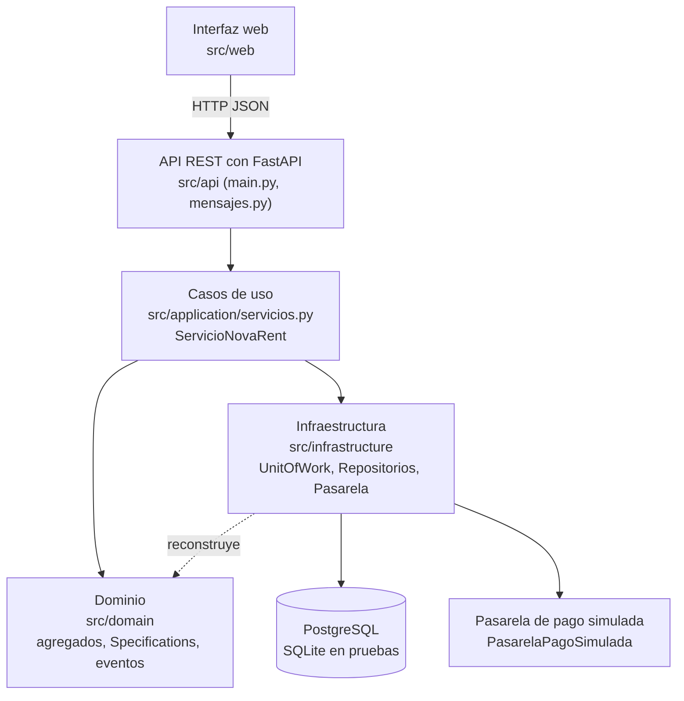
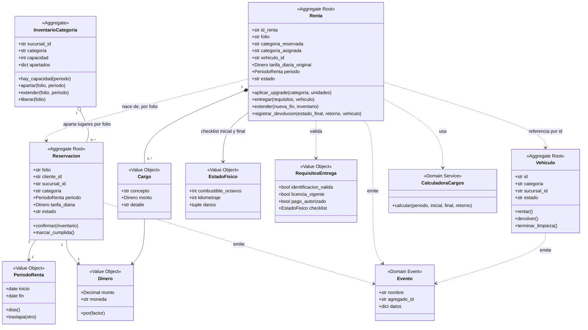
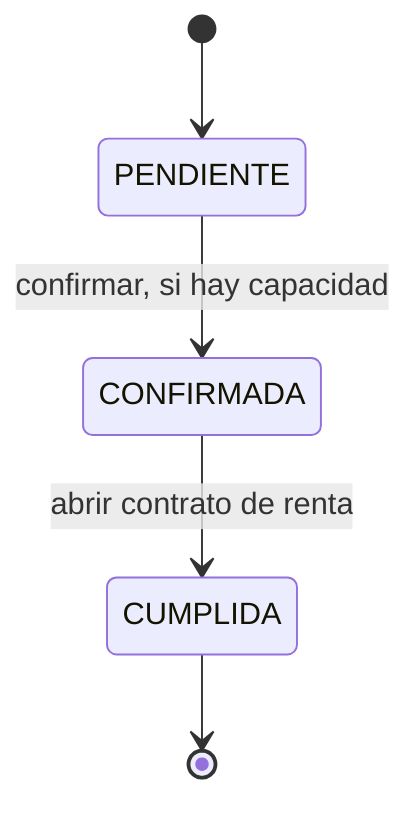
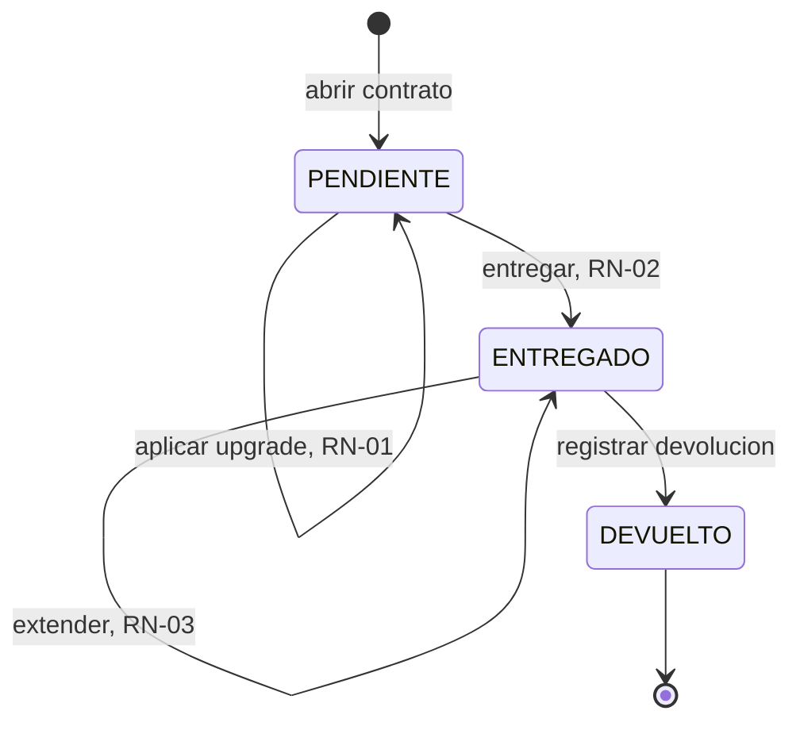
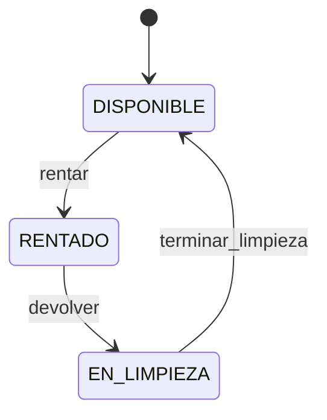
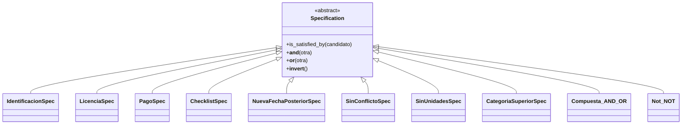
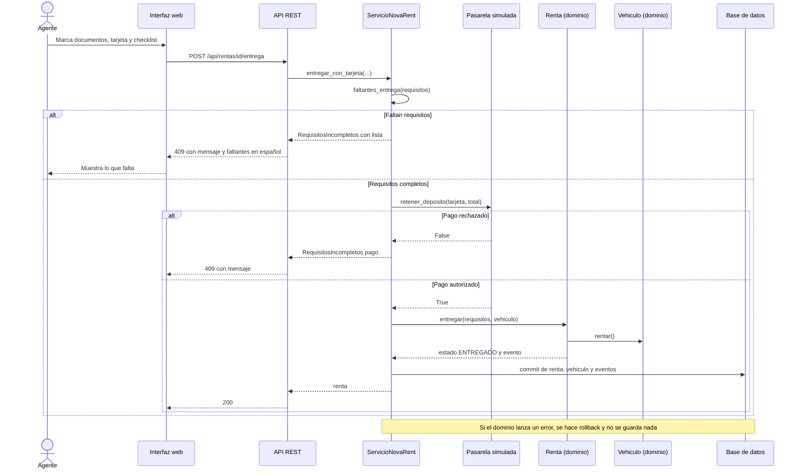
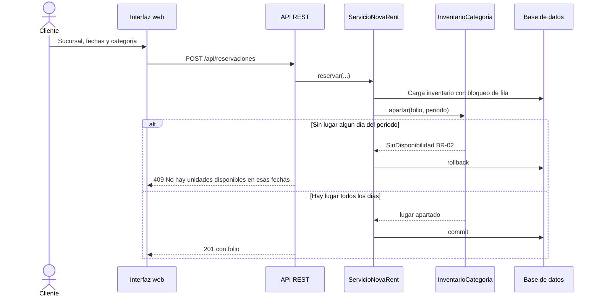
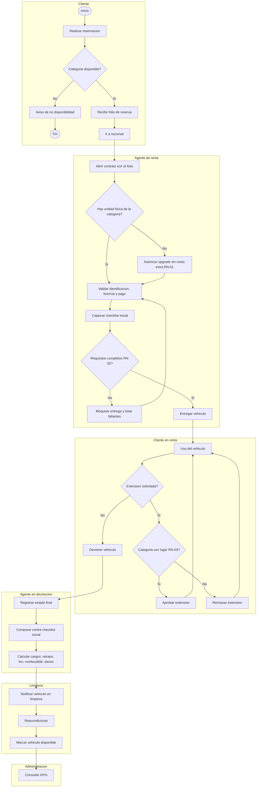

# Diagramas de arquitectura y dominio — NovaRent

Los diagramas están en **Mermaid**: GitHub los dibuja directamente al abrir este archivo. Para el reporte PDF, exporta cada uno como imagen desde <https://mermaid.live> (pega el bloque, descarga PNG/SVG).

Cada diagrama refleja el código de `src/`; el nombre de la clase o archivo está en el texto para poder rastrearlo.

---

## 1. Arquitectura por capas

La interfaz no conoce la base de datos y el dominio no conoce a FastAPI ni a SQLAlchemy (regla de dependencia hacia adentro).

| Capa | Responsabilidad | Ejemplo |
|---|---|---|
| Web | Mostrar solo el campo `mensaje` de los errores | `src/web/app.js` |
| API | Validar la forma de los datos, traducir errores de dominio a lenguaje de cliente | `clasificar()` en `mensajes.py` |
| Aplicación | Una transacción por caso de uso (commit o rollback) | `ServicioNovaRent.reservar` |
| Dominio | Reglas del BRD, sin dependencias externas | `Renta.entregar`, `upgrade_permitido` |
| Infraestructura | Persistir y cobrar (simulado) | `UnitOfWork`, `Repositorio*` |

---

## 2. Modelo de dominio (DDD)

Tres agregados raíz (`Reservacion`, `Renta`, `Vehiculo`), un agregado de capacidad (`InventarioCategoria`) y Value Objects inmutables. Los agregados se referencian **por identificador** (folio, id de vehículo), nunca por objeto, para mantener transacciones pequeñas.

### Eventos de dominio

| Evento | Lo emite | Historia |
|---|---|---|
| `ReservacionConfirmada` | `Reservacion.confirmar` | US-02, US-03 |
| `UpgradeAplicado` | `Renta.aplicar_upgrade` | US-14 |
| `VehiculoEntregado` | `Renta.entregar` | US-04..US-07 |
| `RentaExtendida` | `Renta.extender` | US-08 |
| `VehiculoDevuelto` | `Renta.registrar_devolucion` | US-09 |
| `CargoGenerado` | `Renta.registrar_devolucion` (solo si hay cargos) | US-10, US-11 |
| `VehiculoEnLimpieza` | `Vehiculo.devolver` | US-12, BR-04 |
| `VehiculoDisponible` | `Vehiculo.terminar_limpieza` | US-13 |

---

## 3. Máquinas de estado

**Reservación**

**Renta**

**Vehículo** (ciclo físico de la unidad, BRD §4)

Cualquier otra transición lanza `TransicionInvalida` (el dominio no permite, por ejemplo, rentar un vehículo `EN_LIMPIEZA`).

---

## 4. Specifications (RN-01, RN-02, RN-03)

Cada regla es una combinación de condiciones pequeñas con `&`, `|` y `~`.

| Regla | Composición | Candidato |
|---|---|---|
| RN-02 `requisitos_completos` | `IdentificacionSpec & LicenciaSpec & PagoSpec & ChecklistSpec` | `RequisitosEntrega` |
| RN-03 `extension_permitida` | `NuevaFechaPosteriorSpec & SinConflictoSpec` | `SolicitudExtension` |
| RN-01 `upgrade_permitido` | `SinUnidadesSpec & CategoriaSuperiorSpec` | `SolicitudUpgrade` |

`faltantes_entrega()` recorre las mismas Specifications para devolver la lista legible de lo que falta (US-07).

---

## 5. Secuencia: entrega del vehículo (flujo principal y excepcional)

## 6. Secuencia: reservar y bloquear inventario (US-02, US-03, BR-02)

---

## 7. Proceso de negocio actualizado (BPMN)

Cambios respecto al BPMN original (ver `ADR-002`): el **checklist inicial se captura antes de entregar** (requisito de la entrega, glosario D023 y US-07) y se agrega la rama de **upgrade** (RN-01).

